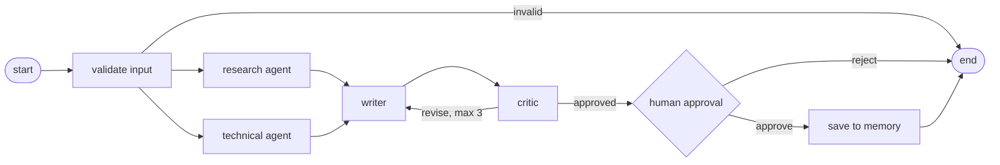

# Multi-Agent Investment Analysis

A stock analysis system where specialized AI agents research a company, analyze its price trends, write a Buy/Hold/Sell report, review each other's work, and wait for a person's approval before anything is saved. Built with LangGraph.

It started as a prototype. This version hardens it into something closer to a production agent system: guardrails, human approval, an audit trail, observability, evaluations, retries and caching, a REST API, and CI.

> A learning project. Reports are not investment advice.

## Why I built it

I didn't just want to use AI agents. I wanted to understand how they really work underneath: how agents hand work to each other and share state, how you stop one from looping forever, how much it should be trusted to act on its own, and how you'd know if it was quietly getting things wrong. Building a complete system was the only way I knew to answer those questions. Stock analysis made a great testbed, because it naturally splits into separate jobs (research, technical analysis, writing, and review), and because a report is only useful if it's grounded in real numbers, mistakes are easy to spot.

That's exactly what happened. My first version produced convincing reports, but when I traced the data step by step, the writer was receiving the agents' *requests* for data instead of the data itself. Nothing crashed; the output just looked right. That lesson, that a good-looking answer isn't proof a system works, is what drove everything after it. Each layer in this version exists because I wanted to understand one more part of building agents people can trust: guardrails and human approval to learn where autonomy should stop, tracing to see what every step really did, evaluations to measure quality instead of eyeballing it, and retries, caching, and an API to see what it takes to make an agent reliable in real use.

## How it works



| Step | What it does |
|---|---|
| **Validate** | Rejects anything that isn't a valid ticker before any tokens are spent |
| **Research agent** | Fetches price data, recent news, and past reports for the ticker (ReAct tool loop) |
| **Technical agent** | Computes RSI, MACD, SMA-20 and 20-day Bollinger Bands (ReAct tool loop) |
| **Writer** | Combines both into a report with a Buy/Hold/Sell call, using only the data provided |
| **Critic** | Checks recency, grounding, and clarity; approves or sends feedback, up to 3 revisions |
| **Approval** | Pauses the run until a person approves or rejects the report |
| **Memory** | Saves the approved report per ticker, so the next run has historical context |

Research and technical analysis run **in parallel**, since neither depends on the other; the writer waits for both.

## Production layers

| Layer | What's implemented | Where |
|---|---|---|
| **Guardrails** | Input validation; a step limit on each sub-agent's tool loop; critic with revision cap; human approval before saving | `guardrails.py`, `graph.py` |
| **Audit** | Every decision (input rejected, critic verdict, approval, save) logged with its trace ID | `audit.py`, `GET /audit` |
| **Observability** | JSON logs with a trace ID per run; per-step timing and token usage; optional LangSmith tracing | `observability.py` |
| **Evaluation** | Fixed ticker dataset; scorers for recommendation, disclaimer, and grounding (do the report's numbers appear in the source data?); optional LLM judge; comparison against a baseline run | `evals/` |
| **Resilience** | Retries with exponential backoff on data downloads; time-based cache | `resilience.py`, `tools.py` |
| **Optimization** | Price history fetched once and shared by both agents; cheaper model for the critic; cost estimate per run | `tools.py`, `settings.py`, `service.py` |
| **Serving** | REST API with an approval workflow; Streamlit UI with Approve/Reject | `api.py`, `playground.py` |
| **Delivery** | 33 tests with scripted fake models (no API keys needed); CI runs them on every PR; Dockerfile | `tests/`, `.github/workflows/ci.yml` |

## Project structure

```
graph.py          LangGraph workflow: state, nodes, routing
tools.py          Data, indicator, search, formatting and memory tools
guardrails.py     Input validation
service.py        Start, pause, resume and inspect runs (used by API, UI and evals)
api.py            FastAPI REST API
playground.py     Streamlit UI
observability.py  Trace IDs, structured logs, usage and cost tracking
audit.py          Append-only decision log
resilience.py     Retries and caching
settings.py       All configuration, from environment variables
evals/            Dataset, scorers and evaluation runner
tests/            Unit and integration tests
```

## Running it

```bash
pip install -r requirements.txt
cp .env.example .env          # then add your OPENAI_API_KEY

pytest -v                     # 33 tests, no API key needed
streamlit run playground.py   # UI with Approve/Reject
uvicorn api:app --reload      # REST API, docs at http://127.0.0.1:8000/docs
python -m evals.run_evals     # evaluation run over 10 tickers
```

### API

| Endpoint | Purpose |
|---|---|
| `POST /reports` `{"ticker": "AAPL"}` | Start an analysis; returns `awaiting_approval` with the draft |
| `POST /reports/{run_id}/decision` `{"approved": true}` | Approve or reject the draft |
| `GET /reports/{run_id}` | Status, report, and metrics (time, tokens, estimated cost) |
| `GET /audit?ticker=AAPL` | Every decision made for a ticker |
| `GET /health` | Status and configured models |

## Evaluation

`python -m evals.run_evals` runs the system on a fixed set of 10 tickers and reports:

- **Completion rate** and **recommendation rate**
- **Grounding ratio:** share of figures in the report that appear in the agents' source data, a cheap check for made-up numbers
- **Average revisions, latency, tokens, and estimated cost**
- **LLM judge score** (with `--judge`): a 1 to 5 grounding score

Results are saved to `evals/results/`, and `--baseline <file>` compares a new run against an earlier one, so prompt or model changes are judged by numbers, not by a few examples.

## Design decisions

- **One job per agent, with only the tools it needs.** Focused prompts are more reliable, and each agent can be debugged alone.
- **LLMs for judgment, code for guarantees.** Validation, formatting, saving, and audit logging always happen, so they're plain code rather than something a prompt asks the model to do.
- **Analysis runs freely; actions need approval.** Reading data is low risk. Saving a report that others may rely on goes through a person first.
- **Every dependency is injectable.** Models, tools, memory, and the audit log are passed into `build_graph`, which is how the whole workflow is tested with scripted models.
- **Fail gracefully.** A data outage is retried; a sub-agent that loops too long stops with a note instead of hanging the run.

## Next steps

- Add a fundamentals agent (earnings, revenue, valuation), the biggest gap in the analysis today
- A database-backed checkpointer so paused runs survive restarts
- Run analyses asynchronously through a queue instead of inside the request
- Track how recommendations change between runs for the same ticker
