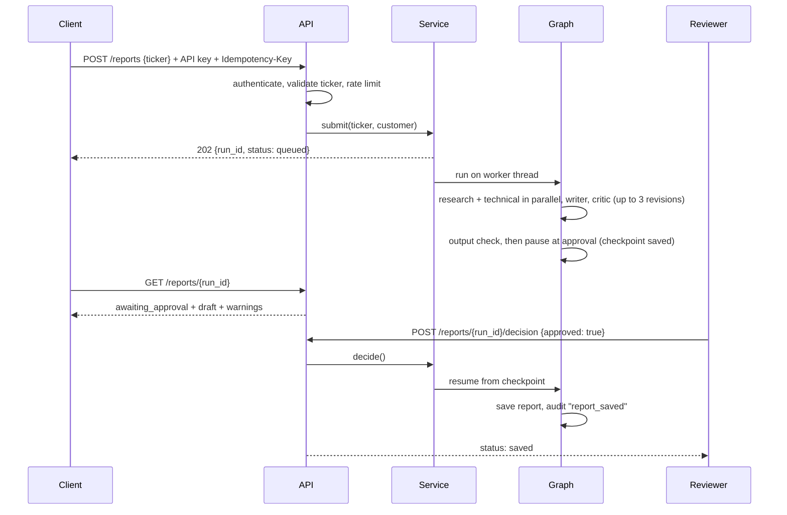

# System Design

How the investment agent is built as a system: requirements, architecture, data, failure handling, security, and how it would scale. The agent workflow itself (which agents run, in what order) is in the [README](../README.md#how-it-works).

## 1. Requirements

**Functional**

- A customer submits a ticker and gets a Buy/Hold/Sell report grounded in real price data and recent news.
- Reports are tailored to the customer's context (risk tolerance, time horizon).
- A person approves every report before it is saved or relied on.
- Every decision the system makes can be looked up afterwards.

**Non-functional**

| Requirement | Target | How it's met |
|---|---|---|
| Trustworthy output | No made-up numbers; a clear recommendation every time | Grounded prompts, critic loop, code-based output check, grounding evals |
| Safety | No action without a person's approval; customers can't see each other's data | Human-in-the-loop interrupt, API keys mapped to customers |
| Latency | API answers in milliseconds even though a run takes up to 2 minutes | Async mode: `202 Accepted`, then poll |
| Cost | ≤ $0.05 per run on average | Shared data fetch, caching, cheaper critic model; enforced by the deployment gate |
| Reliability | A data outage, crash or restart never loses a run | Retries with backoff, durable checkpoints, failed runs recorded |
| Changeability | A prompt change can be measured and rolled back | Versioned skills, evals, deployment gate, version pinning |

## 2. Back-of-envelope scale

These are planning assumptions, not measurements.

- 500 customers × 20 reports a day = **10,000 runs a day**, about 0.12 runs a second on average, maybe 1–2 a second at peak.
- Each run makes roughly 8–12 LLM calls (two ReAct sub-agents, the writer, the critic, up to 3 revisions).
- At up to 2 minutes a run and 2 runs a second at peak, about **240 runs are in flight at once**. That's why runs go on a queue with a worker pool, instead of holding an HTTP request open.
- The bottleneck is the LLM provider's rate limit and cost, not CPU or the database. Data volume is small: about 10,000 rows a day in `runs`, plus checkpoints.

## 3. Architecture

```mermaid
flowchart LR
    client[Client or UI] -->|X-API-Key| api[FastAPI<br/>auth, rate limit,<br/>idempotency]
    api --> svc[AnalysisService<br/>start / submit / decide]
    svc -->|async mode| pool[Worker pool]
    svc -->|sync mode| graph
    pool --> graph[LangGraph workflow]
    graph --> llm[(LLM provider<br/>gpt-4o, gpt-4o-mini)]
    graph --> tools[Tools<br/>prices, indicators,<br/>web search, memory]
    tools --> cache[(TTL cache)]
    tools --> yahoo[(Yahoo Finance)]
    tools --> web[(Web search)]
    graph --> ckpt[(Checkpoints<br/>SQLite)]
    svc --> runs[(Run store<br/>SQLite)]
    graph --> ctx[(Customer context<br/>SQLite)]
    graph --> audit[(Audit log<br/>JSONL)]
    graph -. logs, traces .-> obs[Structured logs<br/>+ LangSmith]
```

| Layer | Responsibility | Where |
|---|---|---|
| API | Validation, authentication, tenant isolation, rate limiting, idempotency | `api.py`, `security.py` |
| Service | One entry point for API, UI and evals; sync or async runs; pause and resume | `service.py` |
| Orchestration | Agent graph: parallel fan-out, critic loop, approval interrupt | `graph.py` |
| Skills | Every prompt is a versioned, reusable skill | `skills.py` |
| Tools | Data fetching with retries and caching; untrusted content wrapped | `tools.py`, `resilience.py` |
| Guardrails | Input validation, step limits, revision cap, output check, prompt-injection defense, human approval | `guardrails.py`, `graph.py` |
| State | Checkpoints, run records, customer context, report memory | `store.py`, `context.py`, `tools.py` |
| Observability | JSON logs with a trace ID, per-step timing, tokens and cost, optional LangSmith traces | `observability.py` |
| Audit | Append-only record of every decision | `audit.py` |
| Quality | Eval dataset, scorers, LLM judge, deployment gate | `evals/` |

## 4. Request lifecycle



## 5. Data model

| Store | Key fields | Why it exists |
|---|---|---|
| `runs` (SQLite) | `run_id` PK, `customer_id`, `ticker`, `status`, `trace_id`, `cost_usd`, `duration_ms`, `idempotency_key`, `created_at` | Status of every run, even queued or failed ones; feeds `/metrics`. Unique index on (`customer_id`, `idempotency_key`) |
| Checkpoints (SQLite) | `thread_id` = `run_id` | Full graph state after every step, so a paused run survives a restart |
| `customer_context` (SQLite) | `customer_id` PK, validated JSON | Structured facts every agent reads before acting |
| Audit log (JSONL) | `ts`, `trace_id`, `ticker`, `event`, `details` | Append-only answer to "what did it decide, and why?" |
| Report memory (JSON) | ticker → list of approved reports | Historical context for the next run; written atomically under a lock |

Run status moves through: `queued` → `running` → `awaiting_approval` → `saved` or `rejected`, with `rejected_input` and `failed` as other final states.

## 6. Failure modes

| Failure | What happens |
|---|---|
| Yahoo Finance errors or times out | Up to 3 attempts with exponential backoff; results cached for an hour |
| A sub-agent loops on tool calls | Step limit stops it; the run continues with a note instead of hanging |
| Writer and critic never agree | Revision cap of 3; the latest draft goes to the reviewer with any open issues as warnings |
| Critic says APPROVED but the report has no recommendation | Code-based output check sends it back anyway |
| Web page contains "ignore previous instructions" | Phrase removed and logged; content wrapped as untrusted data; read-only tools and human approval limit damage |
| Server restarts while a run waits for approval | Checkpoint in SQLite; the run can still be approved afterwards |
| A worker crashes mid-run | Exception caught; run recorded as `failed` with the error, never silently lost |
| Client retries a timed-out `POST /reports` | Same `Idempotency-Key` returns the original run, no second charge |
| One customer floods the API | Token-bucket rate limit returns `429` with `Retry-After` |
| A new prompt makes reports worse | Deployment gate blocks the release; after release, pin the old skill version to roll back |
| Two saves to memory at the same time | Per-file lock plus atomic write-and-rename |

## 7. Security

- **Authentication:** API key in `X-API-Key`, compared in constant time. Keys map to one customer each; admin keys can see everything.
- **Tenant isolation:** the customer comes from the key, never the request body. Another customer's run returns `404`, so run IDs can't be probed; another customer's context returns `403`. Audit log and metrics are admin only.
- **Least privilege for agents:** agents only get read-only tools. The research agent's memory tool refuses `save`; reports are saved by plain code, and only after a person approves.
- **Untrusted input:** tickers are validated by pattern before any tokens are spent; web results are wrapped and scrubbed before they reach a prompt.
- **Secrets:** read from the environment, never committed (`.env` is git-ignored).

## 8. Scaling to production

The current build runs on one machine. The interfaces were chosen so each piece can be swapped without changing the graph:

| Today | At scale | Why |
|---|---|---|
| Thread pool in the API process | Queue (SQS or Celery + Redis) feeding a separate, autoscaled worker fleet | API servers stay stateless; workers scale with queue depth |
| SQLite | Postgres (runs, checkpoints, context) | Many servers sharing one database; LangGraph has a Postgres checkpointer |
| In-process TTL cache and rate-limit buckets | Redis | Shared across every server |
| JSON file memory | Postgres table, plus a vector index when history grows | Concurrent writers; semantic retrieval of past reports |
| JSONL audit log | Append-only table or log pipeline, with retention rules | Queryable and tamper-evident |
| Env-variable API keys | Hashed keys in the database, or OAuth/SSO | Rotation and revocation |
| Direct LLM calls | An LLM gateway with provider fallback, per-customer token budgets and request queuing | The provider's rate limit is the real bottleneck |
| JSON logs + optional LangSmith | OpenTelemetry to Datadog or Grafana; alerts on failure rate, p95 latency, cost per run | Hypercare and on-call |

## 9. Key trade-offs

- **Fixed graph vs a fully autonomous agent.** The overall flow is fixed in code, and only the sub-agents choose their own tool calls. That's less flexible, but predictable, testable and cheap to debug.
- **Human approval vs speed.** Every report waits for a person. Safe for anything others rely on; the `REQUIRE_APPROVAL` switch exists for unattended eval runs, and an agent could earn auto-approval for low-risk cases once evals show it's reliable.
- **Critic loop vs cost.** Each revision costs tokens and time. The cap of 3 and a cheaper critic model bound both.
- **Async vs simplicity.** Async mode adds polling, but an HTTP request should never wait 2 minutes.
- **Regex injection filter vs a classifier.** The filter is cheap and catches the obvious cases. It's one layer among several, not the main defense.
- **Simple stores now.** SQLite and JSON files keep the project runnable with one command; the table above is the path off them.
